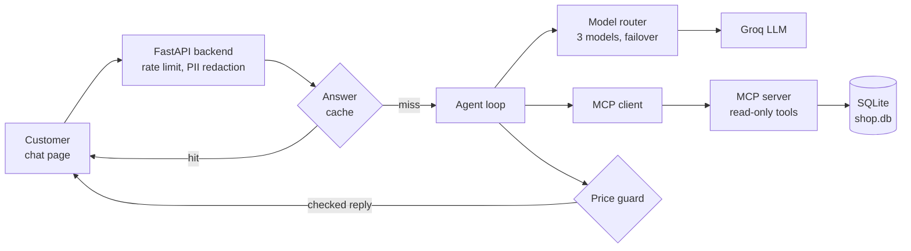
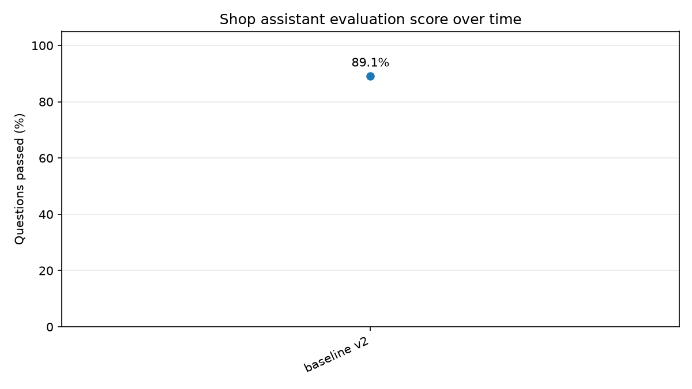

# Anbhu Enterprises Shop Assistant

An AI chat assistant for a printing, Xerox and e-sevai shop in Pallavaram, Chennai. Customers ask about prices, services, opening hours and the shop address. The assistant answers from the shop's own database and **never makes up a price**.

> **Live demo:** `https://mcp-server-chat-bot.onrender.com/`

## What it does

- Answers price questions for fixed-fee services (PAN card, Aadhar correction, passport, voter ID, smart card, online certificates and more).
- Gives a per-page quote for printing and photocopying, including bulk discounts and add-ons such as binding.
- Tells the customer to contact or visit the shop for services that have no fixed price (about 28 services such as LLR, driving licence, ticket booking).
- Tells the customer whether the shop is open now, tomorrow, or on any date, with holidays handled.
- Gives the shop address and phone number from the database.
- Counts the pages of an uploaded PDF and quotes the printing price.

## Architecture



The language model never touches the database. It can only call a small set of **read-only tools** exposed by an MCP server, and every price it states must come from a tool result.

## Safety and reliability features

| Feature | What it does |
|---|---|
| **Read-only database** | The app never writes to SQLite. A test checks that every SQL statement in the code is a `SELECT`. |
| **Price guard** (`backend/guards.py`) | Every amount in a reply (INR, Rs, rupee sign) must appear in a money field (price, total, price per page and so on) of a tool result from the same conversation. Page counts, copies and discount percentages never count as prices. Otherwise the reply is replaced with "Sorry, I could not confirm that price. Please contact or visit the shop for the exact charge." |
| **Model fallback** (`backend/llm_router.py`) | An ordered list of models. If one is rate-limited or fails, the next one answers in about a second. A failing model is skipped for a cool-down period. Hard questions go to the larger model first. |
| **Answer cache** (`backend/cache.py`) | Repeated first questions are answered from memory with no model call. The cache clears itself when `shop.db` changes, entries expire after 2 hours, and answers that depend on the time (open now, hours) or that failed are never cached. |
| **Forgiving name matching** | "pancard", "aadhaar", "voterid", "tirupathi dharshan" and similar spellings still find the right service. |
| **PII redaction** | Aadhar and PAN numbers in replies are removed. The bot never asks for a full ID number. |
| **Rate limiting** | 10 requests per minute per visitor, using the real visitor address behind Render's proxy. |
| **Scope control** | Declines general-knowledge, coding and similar questions, and does not reveal its instructions. |

## Evaluation

The project has a measured test harness, not just a demo. `tests/eval_chat.py` sends real questions to the running bot and checks each reply with keyword rules: the right price must appear, forbidden things (such as a price for a contact-only service, or a leaked system prompt) must not. Backend errors are counted separately from wrong answers. Every run is saved to `tests/eval_history.csv`, and `tests/plot_eval.py` draws the progress chart.



| Run | Change | Score |
|---|---|---|
| baseline v2 | first stable version | 49/55 (89.1%) |
| baseline v3 | prompt tuning | 47/55 (85.5%) |
| model fallback | three-model chain | 50/55 (90.9%) |
| price guard | amounts checked against tool results | 47/55 (85.5%) |
| english only | shorter prompt, cache, English-only replies | 51/60 (85.0%) |
| guard fix | price guard accepts money fields only, contact prompt fixed | 51/53 (96.2%) |

Notes on reading the scores: the questions are answered by a live model, so a run can vary by about 5 points. The question set grew over time, so compare runs by category as well as by total. Tamil-script questions are skipped with `--english-only`, because the bot currently replies in English. The 22 October run used X questions, so compare it with earlier runs by category, not only by total.

Other measurements:

- **Prompt size:** about 2,200 tokens per call before optimisation, about 1,390 after (shorter prompt, shorter tool descriptions, unused tool hidden from the model).
- **Automated tests:** 83 tests (`python -m pytest tests -v`) covering prices, name matching, contact-only services, print quote maths, bulk discounts, opening hours and holidays, the read-only check, the price guard, the model router and the cache.

## Tech stack

Python, FastAPI, SQLite, MCP (FastMCP, streamable HTTP), Groq (OpenAI-compatible tool calling), slowapi, pytest, plain HTML/JS frontend, Render for hosting.

## Project structure

```
backend/
  main.py          FastAPI app: /chat, /upload-quote, /health, rate limit, PII redaction
  agent.py         system prompt, agent loop, tool calling, cache and guard hooks
  llm_router.py    model chains, failover, cool-down
  guards.py        price guard
  cache.py         answer cache
mcp_server/
  server.py        read-only tools exposed over MCP
database/
  schema.sql       tables
  seed_data.py     services, prices, hours, holidays, FAQs, shop address and phone
  db.py            all SQL, name matching, price logic
  shop.db          the generated SQLite database
frontend/
  index.html       chat page
tests/
  test_db.py, test_guard_router.py, test_cache.py   automated tests
  eval_chat.py, plot_eval.py                        evaluation harness and chart
  load_test.py                                      concurrent-user test
  eval_history.csv, eval_progress.png               recorded results
```

## Run it locally (Windows PowerShell)

1. Create the environment and install packages:
   ```powershell
   python -m venv .venv
   .venv\Scripts\activate
   pip install -r requirements.txt
   ```
2. Get a free API key from [console.groq.com](https://console.groq.com) and put it in `backend/.env`:
   ```
   GROQ_API_KEY=your_key_here
   ```
   This file is ignored by git. Never commit it.
3. Edit the shop details at the top of `database/seed_data.py` (`SHOP_ADDRESS`, `SHOP_PHONE`, and so on), then build the database:
   ```powershell
   cd database
   Remove-Item shop.db -ErrorAction SilentlyContinue
   python seed_data.py
   cd ..
   ```
4. Start the two servers, **MCP server first**, each in its own window:
   ```powershell
   python mcp_server\server.py
   ```
   ```powershell
   cd backend
   uvicorn main:app --reload --port 8000
   ```
5. Open `http://127.0.0.1:8000`.

## Run the tests

```powershell
python -m pytest tests -v
```

To score the live bot, start the backend with the cache switched off so repeated questions are really answered by the model:

```powershell
cd backend
$env:ANSWER_CACHE="off"
uvicorn main:app --port 8000
```

Then, from another window:

```powershell
python tests\eval_chat.py --english-only --label "my change" --pause 10
python tests\plot_eval.py
python tests\load_test.py --users 10
```

## Change prices and services

All data lives in `database/seed_data.py`. A service with rows in `service_pricing` has fixed prices. A service without any is answered with "contact or visit the shop". Per-page services use the `pricing` table. After editing, rebuild `shop.db` as in step 3 above and restart the servers. The answer cache clears by itself when the database file changes.

If you add a new price field to a tool result (for example `fee` or `deposit`), add its name to `MONEY_KEYS` in `backend/guards.py`. Otherwise the price guard will block replies that quote it.

## Deploy on Render

`start.sh` starts both the MCP server and the backend. Set `GROQ_API_KEY` as an environment variable in the Render dashboard. `database/shop.db` is part of the repository, so commit it after rebuilding. The free tier sleeps after about 15 minutes without traffic, so a free uptime pinger on `/health` keeps it awake.

## Known limitations

- Replies are in English only. Tamil and Tanglish questions are understood but answered in English.
- Chat history is kept in memory and is lost when the server restarts.
- CORS is currently open (`*`) and should be restricted to the shop's website before wider use.
- The Groq free tier has per-minute token limits. The cache and the fallback chain reduce the effect, but a sudden crowd can still be slowed down.
- The rate limit trusts the visitor address sent by the proxy, so a determined person could get around it.
- The price guard checks that an amount exists in a money field of a tool result. It does not check that the amount belongs to the service the customer asked about.

## Possible next steps

Restrict CORS, add Cloudflare Turnstile, add a "documents to bring" FAQ for each service, add a daily summary of unanswered questions for the shop owner, match each quoted price to its own service in the price guard, and add CI that runs the tests on every push.

## License

MIT. See the [LICENSE](LICENSE) file.